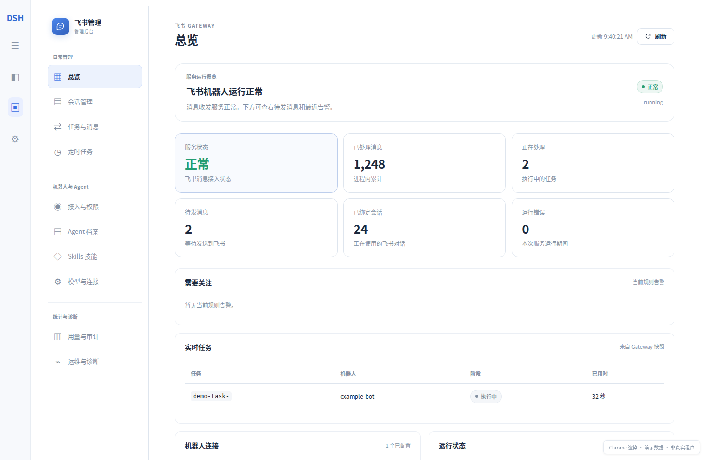
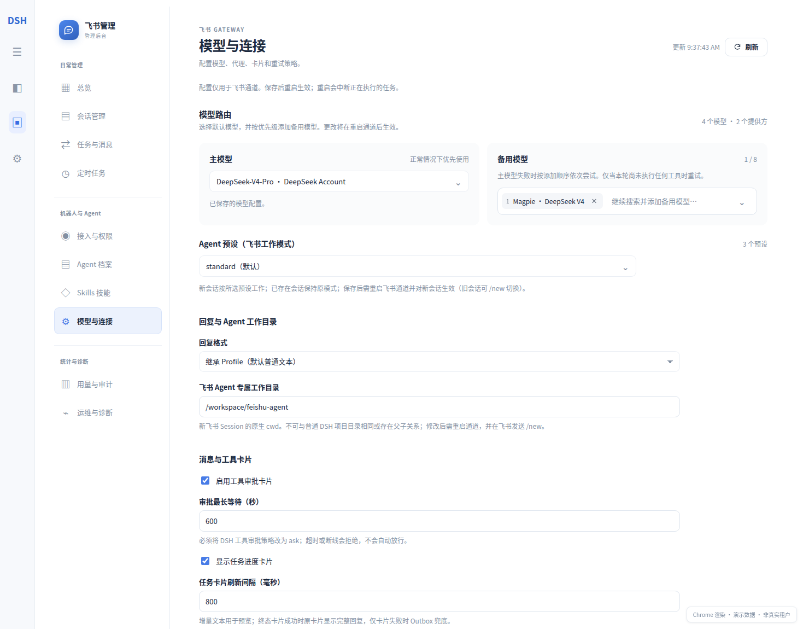
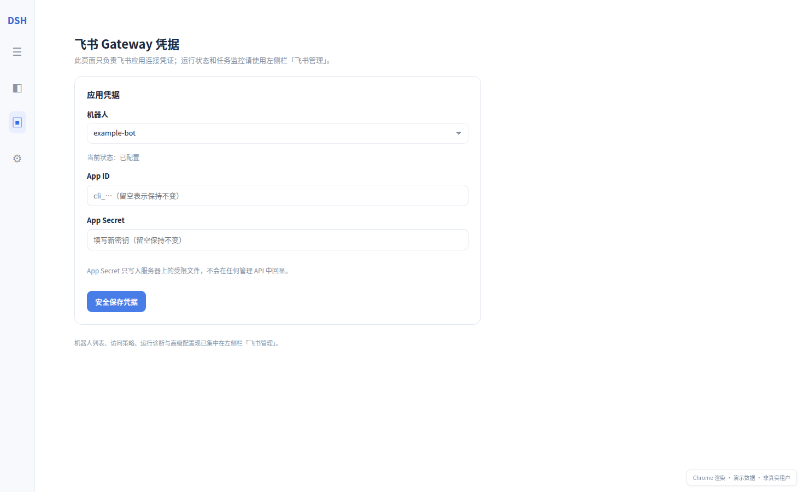

# DSH Feishu Gateway

[](https://github.com/WeipengMO/dsh-plugin-feishu-gateway/actions/workflows/ci.yml)
[](https://github.com/WeipengMO/dsh-plugin-feishu-gateway/actions/workflows/security.yml)
[](https://www.npmjs.com/package/dsh-plugin-feishu-gateway)
[](https://www.npmjs.com/package/dsh-plugin-feishu-admin)
[](package.json)
[](LICENSE)

让飞书机器人直接使用 **DSH 原生 Agent、Session、模型和工具**，并在 DSH Web 中管理聊天、任务与运行状态。Gateway 负责消息与执行，Web Admin 负责可视化管理；不需要另建 Agent 服务。

> **当前测试版**：[`v0.1.0-beta.1`](https://github.com/WeipengMO/dsh-plugin-feishu-gateway/releases/tag/v0.1.0-beta.1) 已在 GitHub Releases 提供 Gateway 和 Web Admin 两个安装包；npm 发布情况请以 npm Registry 为准。

> **版本说明**：源码版本以 [Gateway package.json](package.json) 和 [Web Admin package.json](web-admin/package.json) 为准。npm 徽章显示的是**已发布版本**，不代表当前源码或 VPS 安装的版本。测试与升级前请核对两个安装包的具体版本。

## 能做什么

- **飞书聊天**：私聊与受控群聊、@ 触发、成员权限、按聊天隔离上下文、`/new`、`/cancel` 等命令。
- **原生对话与上下文压缩**：由 DSH 保存 Session 和历史；Gateway 复用 DSH 原生上下文自动压缩，并提供飞书 `/context`、`/compact` 查询与手动触发，后台可查看状态。历史归档/恢复与上下文压缩是不同功能。
- **任务和审批**：流式卡片、任务取消、DSH 原生工具审批、结果通知。
- **自动化**：管理 DSH 原生定时任务，并把执行结果推送到授权的飞书聊天。
- **管理后台**：模型与备用模型、Agent 预设（飞书工作模式）、机器人/群聊权限、Agent 档案、**飞书专属 Skills**、Token 用量、消息投递、代理及运行诊断。
- **可靠性**：持久化 Inbox/Outbox、消息去重、保守重试与重启恢复；不自动重放可能已经产生副作用的任务。

**手动永久删除通过可选的 `@michengai/dsh-archive-manager` 提供**（安装于 DSH Web `web` Profile）；没有安装时「删除」按钮保持灰色，其他功能正常运行。自动永久删除和按期限物理清理尚未实现（[Issue #37](https://github.com/WeipengMO/dsh-plugin-feishu-gateway/issues/37)）；图片/文件双向传输也不应视为已实现。**归档和解除飞书关联均不会删除 DSH 对话内容或回收其磁盘空间。**

## 安装与首次使用

本插件由两个独立的包组成，需要安装在**同一台 DSH 主机、同一运行用户**的不同 Profile 中：

| 安装包 | DSH Profile | 作用 |
| --- | --- | --- |
| `dsh-plugin-feishu-gateway` | `feishu-channel` | 连接飞书、处理消息并调用 DSH Agent |
| `dsh-plugin-feishu-admin` | `web` | 在 DSH Web 中提供「飞书管理」界面 |

**不要将 Gateway 安装到 `web` Profile。** 已有 DSH Web 的用户仍需要单独配置并运行 `feishu-channel`；安装插件不会自动创建完整的 Agent/模型环境。

### 1. 安装前准备

- 已安装可用的 DSH，Node.js 版本 **≥24.9.0**，DSH 版本满足 **`>=0.2.2-rc.1 <0.3.0-0`**。先运行 `node -v` 和 `dsh --version` 检查。
- `web` Profile 已能正常启动 DSH Web；`feishu-channel` Profile 已配置相应的 DSH Agent/模型。初次配置 Profile 可以参考[首次部署指南](docs/GETTING-STARTED.md)。
- 已在[飞书开放平台](https://open.feishu.cn/app)（国际版：[Lark 开放平台](https://open.larksuite.com/app)）创建企业自建应用，启用机器人、长连接事件 `im.message.receive_v1`，申请消息权限并发布应用版本。详见[飞书应用配置](docs/FEISHU-APP.md)。

### 2. 下载并安装插件（当前推荐）

当前 GitHub 测试版为 **`v0.1.0-beta.1`**。打开[GitHub Releases 下载页面](https://github.com/WeipengMO/dsh-plugin-feishu-gateway/releases/tag/v0.1.0-beta.1)，下载以下三个文件并放在同一目录：

- `dsh-plugin-feishu-gateway-0.1.0-beta.1.tgz`
- `dsh-plugin-feishu-admin-0.1.0-beta.1.tgz`
- `SHA256SUMS`（用于校验下载的安装包）

> 仓库当前为 Private；在公开仓库之前，只有获得仓库访问权限的用户才能下载这些 GitHub Release 资源。

在**运行 DSH 的机器**上打开终端，进入刚才存放三个文件的目录，执行：

```bash
# 进入安装包所在目录：替换成你的真实路径
cd /path/to/downloads

# 检查安装包是否与发布文件一致（Linux）
sha256sum -c SHA256SUMS

# 分别安装到对应 DSH Profile
dsh plugin --profile feishu-channel add ./dsh-plugin-feishu-gateway-0.1.0-beta.1.tgz
dsh plugin --profile web add ./dsh-plugin-feishu-admin-0.1.0-beta.1.tgz

# 检查 Profile 解析的配置
dsh --profile feishu-channel --dump-config
dsh --profile web --dump-config
```

macOS 可以使用 `shasum -a 256 -c SHA256SUMS` 检查包。**如果校验失败，请不要安装**，重新获取完整的三个文件。

### 通过 npm 安装（包发布到 npm 后）

如果两个版本已出现在 npm 上，也可以不下载 `.tgz`，直接执行：

```bash
dsh plugin --profile feishu-channel add dsh-plugin-feishu-gateway@0.1.0-beta.1
dsh plugin --profile web add dsh-plugin-feishu-admin@0.1.0-beta.1
```

可先用 `npm view dsh-plugin-feishu-gateway@0.1.0-beta.1 version` 和 `npm view dsh-plugin-feishu-admin@0.1.0-beta.1 version` 检查是否已经发布。**GitHub Release 存在不代表 npm 已发布**，测试期间请固定版本号，不要直接安装 `latest`。

### 3. 配置飞书机器人

1. 进入 **DSH Web → 设置 → 飞书 Gateway**，填写飞书应用的 **App ID** 和 **App Secret**。若使用独立通道服务，也可以按[首次部署指南](docs/GETTING-STARTED.md)通过受保护的环境变量文件配置。
2. 进入 **飞书管理 → 接入与权限**，添加允许与机器人对话的用户 `open_id`。**白名单为空时，所有私聊均会被拒绝**；群聊默认关闭，需要单独配置。
3. 确认 `feishu-channel` 的 Agent 和模型可用，并按照[部署与启动说明](docs/GETTING-STARTED.md#4-启动通道)启动通道进程或 systemd 服务。**仓库提供的启动脚本不包含在 npm 安装包中，需要单独获取**；安装包更新不会自动重启已经运行的进程。

**不要**把真实 App Secret 写进 Git、README 或截图；不要同时运行两个使用同一 App ID 的 Gateway。

### 4. 验证是否安装成功

- 在 DSH Web 左侧找到 **飞书管理**，查看 Gateway 连接和运行状态。
- 用已加入白名单的飞书账号私聊机器人，发送 `/status`、`/models` 和一条普通消息；确认收到回复。
- 连续发送几条消息验证上下文，再发送 `/new` 检查能否创建新会话。

如果机器人不回复，优先检查：飞书应用的**事件订阅和权限是否已发布**、用户 `open_id` 是否在白名单、Gateway 是否已启动并连接、通道 Profile 的模型凭据是否正常。进一步排障见[运维手册](docs/OPERATIONS.md)。

### 已有安装？如何升级

先备份 Gateway 状态、Profile 配置及飞书凭据，在维护窗口安装匹配的新版本并重启对应服务。不要为了升级而清空会话或状态目录。参见[升级与回滚](docs/OPERATIONS.md#安全升级)。

### 从源码构建（仅开发者需要）

普通用户**无需自行编译**安装包；如需使用仓库提供的服务启动脚本，可以单独获取该脚本。只有需要修改插件或验证开发分支时，才使用下方源码构建命令：

```bash
git clone https://github.com/WeipengMO/dsh-plugin-feishu-gateway.git
cd dsh-plugin-feishu-gateway
pnpm install --frozen-lockfile
pnpm run verify
pnpm run pack
pnpm run release:check
```

生成的两个 `.tgz` 位于 `dist/`，可按上方“下载并安装插件”的方式安装。

## 界面预览

以下截图由 **Google Chrome** 对仓库当前的 Web Admin React 前端进行渲染。为避免暴露凭据、聊天内容和服务器信息，截图使用本地**演示数据**，并非真实飞书租户的运行快照。

**管理后台 · 总览**



**模型与连接**



**DSH 设置 · 飞书 Gateway 凭据**



## 管理界面怎么用

在 DSH Web 左侧打开 **飞书管理**；凭据设置位于 DSH 设置中的 **飞书 Gateway**：

| 入口 | 管理内容 |
| --- | --- |
| 总览 | Gateway 连接状态、运行摘要 |
| 会话管理 | 对话历史、已归档、聊天关联与安全整理 |
| 任务与消息 | 实时任务与消息投递 |
| 定时任务 | 创建、暂停、运行、删除任务及查看执行历史 |
| 接入与权限 | 机器人、群聊、成员白名单和工具执行策略 |
| Agent 档案 | 飞书专用身份、指令、记忆文件与历史版本 |
| Skills 技能 | 创建、粘贴导入、编辑、启停和删除飞书专属 SKILL.md；与 DSH Core 完全隔离 |
| 用量与审计 | Token 统计、模型用量与工具审批记录 |
| 运维与诊断 | 告警、连接和结构化日志 |
| 模型与连接 | 主模型、多个备用模型、Agent 预设（飞书工作模式）、代理和消息卡片选项 |

「会话管理」包含**对话历史 / 已归档 / 飞书聊天关联**，支持对历史执行单条或多选「归档」，以及对已归档历史多选「恢复 / 删除」（单次最多 20 条）。删除需要可选的 `@michengai/dsh-archive-manager` 扩展接口，没有安装时保持灰色；所有确认统一在后台页面内弹窗。90 天自动归档需手动启用，自动永久删除保持关闭。详见 [会话管理说明](docs/SESSION-CENTER-UX.md)。

Skills 仅在飞书 Agent 的独立工作区生效，默认停用，不支持自动下载安装脚本；详细规则和验收步骤见 [飞书专属 Skills](docs/FEISHU-SKILLS.md)。

飞书聊天内可使用 `/help`、`/status`、`/new`、`/cancel`、`/models` 等命令。模型目录以 **Gateway 所在 DSH Profile** 为准，详见 [飞书命令与模型](docs/FEISHU-CHANNEL.md)。


> **可选增强**：永久删除已归档 DSH 对话需要在 **`web` Profile** 安装并启用 `@michengai/dsh-archive-manager`。没安装时「删除」按钮为灰色，归档、恢复和飞书消息功能不受影响。具体步骤见 [会话管理指南](docs/SESSION-CENTER-UX.md)。

## 自动上下文压缩

DSH 原生 `dsh-compaction-basic` 根据模型上下文压力自动压缩较早对话，并在确认溢出后尝试恢复；Gateway 不会另造一个按累计 Token 用量触发的摘要引擎。飞书发送 `/context` 可查看当前 Session 的压缩能力，发送 `/compact` 可调用 DSH 原生手动压缩；Web Admin 会话管理底部也提供只读状态：区分自动、手动、未分类压缩和失败计数；只有观察到真实原生自动压缩事件才显示“已观察到”，否则标明自动策略未验证。自动触发阈值应在 **`feishu-channel` Profile** 的 DSH 压缩后端中配置，而非 Web Admin。详见 [上下文压缩与触发策略](docs/CONTEXT-COMPACTION.md)。

## 开源安全与 CI

仓库通过 [Security CI](.github/workflows/security.yml) 在 PR、主分支更新以及定期扫描中执行：**Git 历史与当前源码的密钥泄露检测、依赖漏洞审计、npm 发布包隐私检查，以及 ClamAV 恶意文件扫描**。常规构建 CI 同时禁止将凭据、会话历史、数据库和日志打入发布包。

安全扫描只提供分层风险检测，**不能保证所有代码绝对无恶意或绝对不泄露隐私**。如发现安全问题，请遵循 [安全报告与处理说明](SECURITY.md)，不要将敏感值粘贴到公开 Issue。公开仓库前还应审查完整 Git 历史，并在仓库规则中将 CI 和 Security 检查设为必需。

## 开源前与测试版验收

运行 `pnpm run pack` 后，执行 `pnpm run release:check` 可对 Gateway 和 Admin 两个 npm 安装包进行发行前检查，并生成 `dist/release-manifest.json` 和 `dist/SHA256SUMS`；CI 也会保存经过检查的双包工件。

**CI 通过不等于真实 DSH / 飞书环境已经验收。** 请按照 [双包发布检查](docs/PRERELEASE.md) 在隔离环境确认安装、权限、群聊、定时任务、Web Admin、升级和回滚。此 CI 不会自动发布 npm。

## 安全与升级原则

- 飞书私聊只允许授权的 `open_id`；群聊默认关闭，需要显式配置策略和成员白名单。
- App Secret 仅由受控环境变量或管理端写入，不能进入 Git；Admin 不回显。
- Gateway 与 Web Admin 在同机同用户部署时协作，**同一状态目录只允许一个 Gateway owner**。
- 正在执行、等待审批、存在未投递消息或被活动定时任务引用的会话，不得通过后台强制执行破坏性清理。
- 提交到 GitHub 或 CI 通过不会更新服务器进程；升级前先保存状态并安排维护窗口。

## 文档导航

**[文档总览](docs/README.md)** · [首次部署](docs/GETTING-STARTED.md) · [日常运维](docs/OPERATIONS.md) · [Web 管理后台](docs/WEB-ADMIN.md) · [会话与历史](docs/SESSION-CENTER-UX.md) · [定时任务](docs/SCHEDULED-TASKS.md) · [开发与测试](docs/DEVELOPMENT.md)

MIT License.
